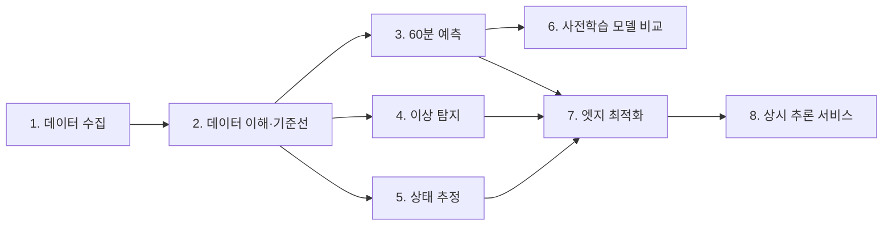

# 시계열 데이터 추론 실습 — 단계별 로드맵

<!-- 수정 기록
- 2026-10-22 과제 2 상태를 완료로, spec 폴더와 진단서 링크 추가
- 2026-10-30 과제 3 상태를 완료로, spec 폴더와 보고서 링크 추가
-->

센서 데이터를 **모으고(1) → 이해하고(2) → 예측·탐지·추정하고(3~6) → 보드에 맞게 줄이고(7) → 상시 서비스로 내놓는다(8)**.
공통 원칙은 [`.specify/memory/constitution.md`](.specify/memory/constitution.md)에 있다.

## 전체 흐름

## 과제별 계획

| 단계 | 과제 | 한 줄 목표 | 핵심 산출물 | 먼저 끝나야 할 것 | spec 폴더 | 상태 |
|---|---|---|---|---|---|---|
| 1 | 데이터 수집 체계 | 운영진 InfluxDB에서 필요한 데이터를 골라 끊김 없이 내 버킷에 저장 | 상시 수집기, 수집 현황 보고 | — | [`specs/001-data-collection`](specs/001-data-collection/) | 완료 (2026-10-21, [보고서](specs/001-data-collection/report.md)) |
| 2 | 데이터 이해와 기준선 | 데이터를 믿을 수 있게 정제하고 넘어야 할 선을 잰다 | 데이터 진단서, 기준선 성능표 | 1 (또는 합성 데이터) | [`specs/002-baseline`](specs/002-baseline/) | 완료 (2026-10-22, [진단서](specs/002-baseline/report.md)) |
| 3 | 60분 예측 | 5분 간격 60분 CO₂·온도 예측 | 모델 비교표, 공간별 분석, 일정 정보 효과 | 2 | [`specs/003-forecast`](specs/003-forecast/) | 완료 (2026-10-25, 온도 기준 통과·CO₂ 기준 미달, [보고서](specs/003-forecast/report.md)) |
| 4 | 이상 탐지 | 고장 5종을 빨리, 헛경보 없이 | 탐지 성적표, 임계값 분석, 운영 제안 | 2 | `specs/004-anomaly` | 대기 |
| 5 | 상태 추정 | 사용 여부 추정, 30분 전 환기 경보 | 분류기 2종 성적표, 혼동 행렬 | 2 | `specs/005-occupancy` | 대기 |
| 6 | 사전학습 모델 비교 | Chronos 등 범용 모델의 실력과 비용 | 비교표, 채택 의견 | 3 | `specs/006-pretrained` | 대기 |
| 7 | 엣지 최적화 | TensorRT FP16으로 빠르고 결과는 같게 | 최적화 보고서 | 3·4·5 | `specs/007-edge` | 대기 |
| 8 | 상시 추론 서비스 | 매분 예측·이상·상태를 MQTT와 API로 제공 | 서비스 v1, 12시간 가동 기록, 결과 형식 문서 | 1·7 | `specs/008-service` | 대기 |

> 2~5는 합성 데이터로 바로 시작할 수 있다. 1번으로 실데이터를 모으는 동안 2~5를 병행한다.

## 정한 것

- 개인 과제로 진행한다. Jetson aip-1을 계정을 나눠 같이 쓴다.
- 원본: 운영진 InfluxDB `https://influx.java21.net`(와이파이) / `10.116.64.13:8086`(내부망), 버킷 `iot-bucket` (MQTT 메시지가 이미 쌓이고 있음. MQTT를 직접 받지 않고 여기서 가져와도 된다고 운영진에게 확인함)
- 가져올 데이터: 실습실(안내문의 강의실)·회의실 × co2·temperature·humidity, 모든 장치
- 저장소: aip-1에 InfluxDB 2.x 설치. 서버 1개, org 1개, 사람마다 버킷 1개(`jiwon`, `seohyun`)와 자기 버킷 전용 토큰
- 언어: Python (배우면서 진행). 과제 1 옮기기 프로그램도 Python
- 과제 1 옮기기: Python 스크립트 + systemd timer(1분마다), 과거 데이터는 2025-08-08부터
- Jetson 설치 프로그램은 노션 설치 기록표에 이유와 함께 남긴다

## 단계마다 반복하는 순서 (spec-kit)

1. `/speckit-specify` — 과제 안내문의 "해결할 것·확인 기준"을 `spec.md`로 옮긴다.
2. `/speckit-clarify` — 모르는 것(접속 정보, 데이터 형식 등)을 질문으로 정리한다.
3. `/speckit-plan` — 어떤 도구·구조로 만들지 `plan.md`에 쓴다.
4. `/speckit-tasks` — 하루 단위로 할 수 있는 작은 할 일로 쪼갠다.
5. `/speckit-implement` — 할 일을 하나씩 하고 체크한다.
6. 산출물과 해석을 남기고 위 표의 상태를 갱신한다.

## 아직 정하지 않은 것 / 확인할 것

- [x] 운영진 DB에서 내 버킷으로 옮기는 방법 → Python 스크립트 + systemd timer
- [ ] 제공 키트 README / CODE_GUIDE 읽기
- [ ] 트랙 결정: 기본(A) / 심화(B)
- [ ] 코드를 GitHub에서 Jetson으로 배포하는 방법
