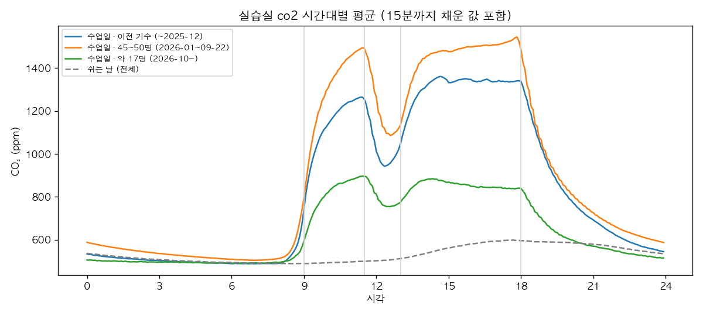
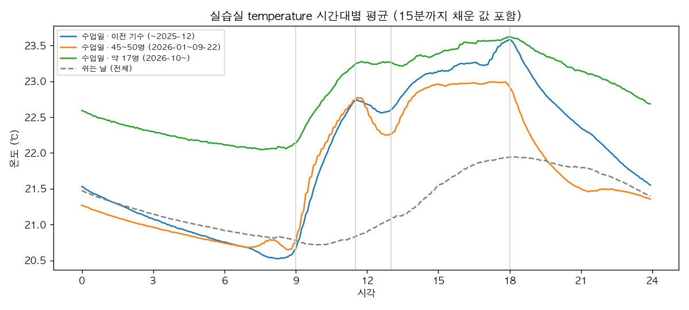
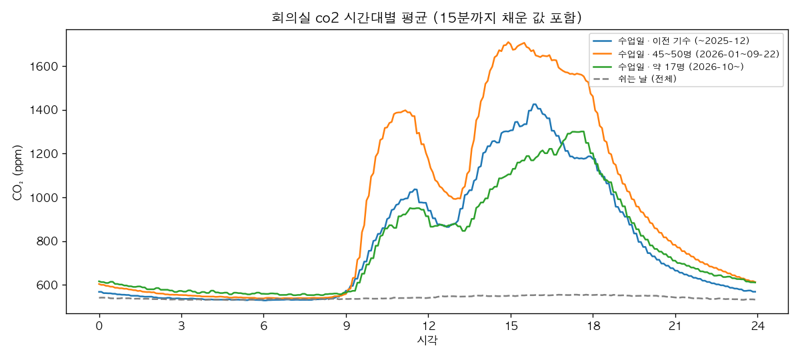
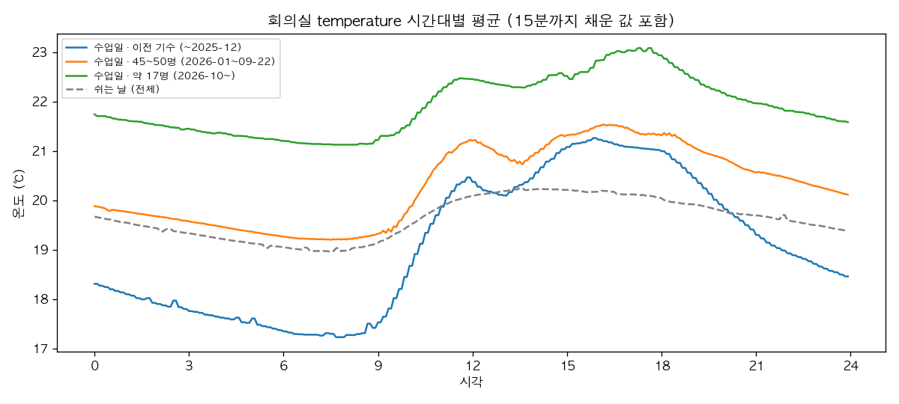

# 과제 2 데이터 진단서

<!-- 수정 기록
- 2026-10-22 초안 작성
- 2026-10-22 검증 기간 인원을 45명 내외로 (지원 확인)
- 2026-10-22 resample.py 최신 출력으로 결측률 채움, [확인] 제거
- 2026-10-22 패턴 그래프 4장과 설명 추가 (figures/)
- 2026-10-22 MAE 뜻 한 줄 추가
- 2026-10-22 섞으면 안 되는 이유를 예시로 풀어 씀
- 2026-10-22 '우리가 한 방식'과 '섞었다면(가정)'을 나눠 다시 씀
- 2026-10-22 섞으면 안 되는 이유를 '이웃 칸 문제가 거의 같다'로 정확히 고침
- 2026-10-22 제거 표를 불가능한 값 / 고장 동반 값 / 재전송으로 나누고 뜻 설명 추가
- 2026-10-22 안 오른 2일이 수업일 평균에 포함됨을 명시 (지원 결정: 그대로 둠)
- 2026-10-22 공간 조건(냉난방기·공기청정기) 추가 (지원 확인)
- 2026-10-22 제목의 (초안) 제거: 확인할 숫자를 모두 채우고 지원 검토를 마침
-->

**측정 조건**: aip-1 InfluxDB 버킷 `jiwon`(교육장 센서, 실습실·회의실 × CO₂·온도·습도). 분석 기간 2025-09-03 ~ 2026-10-21(한국 시각). 실데이터. Mac(Python 3.9, pandas)에서 분석.

**공간 조건 (지원 확인)**: 실습실·회의실 모두 냉난방기는 사람이 직접 켜고 끈다. 켜는 날은 대개 9시 전이고, 아예 안 켜는 날도 있다. 끄는 시각은 마지막 퇴실자가 끄거나 그 전에 끄는 등 날마다 다르다. 실습실 공기청정기는 자동 또는 상시 작동(꺼 두어도 다음 날 켜져 있음)이며 CO₂는 줄이지 못한다. 회의실 공기청정기 유무, 환기 장치 유무는 확인하지 못했다.

## 1. 정제 규칙

| 대상 | 처리 | 이유 |
|---|---|---|
| 시작 전 기록 | 2025-09-03 이전은 버림 | 그 전에는 센서 구분 태그(device_id)가 없어 어느 센서 값인지 모름 |
| 복도 센서 | 버림 | 실습실로 등록됐지만 15~19℃·습도 70~85%로 복도 환경. 실습실 값을 흐림 |
| 재전송 중복 | 같은 센서·항목·값이 1초 안에 또 오면 버림 | 같은 측정이 게이트웨이 2대로 두 번 저장됨. 실습실 기록의 약 10% |
| 불가능한 값 | CO₂ 350 미만·10,000 이상, 습도 0~100 밖, 온도 0℃ 이하 버림 | 10,000은 측정 한계, 65,535는 오류 코드. 7,029까지 매끄럽게 오른 회의는 실제 값이라 상한을 10,000으로 둠 |
| 같은 시각 다른 항목 | 한 항목이 불가능하면 그 센서의 그 시각 전체를 버림 | 고장 난 센서는 CO₂ 65,535와 온도 -0.1, 습도 127.5를 함께 보냄(2026-07-05~06) |
| 센서마다 다른 주기 | 센서마다 5분 칸 평균 → 센서마다 15분까지 앞 값 채우기 → 실습실은 기준 센서 4개의 중앙값 | 주기가 1·2·10분으로 달라서, 칸마다 다른 센서 조합으로 합치면 가짜 출렁임이 생김(트러블슈팅 1) |
| 짧은 결측 (15분 이하) | 앞 값으로 채움, 채운 칸은 표시 | 모델 입력이 비지 않게. 뒤 값을 쓰는 선형 보간은 서비스 때 미래 값을 쓸 수 없어 학습과 서비스가 달라짐 |
| 긴 결측 (15분 초과) | 비워 둠 | 오래된 값으로 채우면 그게 틀린 값이 됨 |
| 채점 | 정답이 진짜 측정값인 칸만 | 채운 값으로 채점하면 실력이 부풀려짐 |

**분석 간격: 5분.** 회의실이 10분, 실습실 일부 센서가 2분마다 보고해서 1분 칸은 대부분 비어 있다. 5분이면 반응 시간(분 단위)을 볼 수 있고, 60분 예측도 12칸이라 다루기 쉽다.

## 2. 기간 나누기

| 기간 | 날짜 | 실습실 사람 수 |
|---|---|---|
| 학습 | 2025-09-03 ~ 2026-08-31 | 이전 기수(40명대 추정) + 45~50명 |
| 검증 | 2026-09-01 ~ 09-30 | 45명 내외 22일 + 과정 사이 휴강 8일(09-23~30) |
| 시험 | 2026-10-01 ~ 10-21 | 약 17명 |

**우리가 한 방식**: 날짜로 통째로 자른다. 8월까지는 전부 학습, 9월은 전부 검증, 10월은 전부 시험이다. 시험 기간(10월)은 학습 때 한 번도 본 적 없는 미래라, 실제 서비스와 같은 조건이다.

**왜 무작위로 섞으면 안 되나 (가정)**: 만약 5분 칸 12만 개를 날짜와 상관없이 제비뽑기로 학습·검증·시험에 나눈다면 이런 문제가 생긴다.
- 예측 문제 하나는 "지난 1시간 값을 보고 60분 뒤 값을 맞혀라"다.
- 10월 15일 10:00의 문제(9:00~10:00을 보고 11:00 맞히기)는 시험에, 바로 옆 9:55의 문제(8:55~9:55를 보고 10:55 맞히기)는 학습에 들어갈 수 있다.
- 두 문제는 입력이 5분만 다르고 답도 거의 같다. 시험 문제가 답을 이미 본 연습 문제와 거의 똑같아진다. 모델이 날짜나 시각을 몰라도 생기는 문제다.
- 그래서 모델이 예측하는 법을 배웠는지, 비슷한 문제의 답을 외웠는지 구분할 수 없고, 시험 점수가 실제 실력보다 좋게 나온다.

우리는 날짜로 잘랐기 때문에 이 문제가 없다.

정규화(값의 크기를 맞추는 데 쓰는 평균·표준편차)도 학습 기간 값으로만 계산했다. 시험 기간 값을 섞으면 미래 정보가 조금 새어 들어가기 때문이다.

## 3. 진단

**결측률과 제거한 값** (5분 칸 119,423개 기준)

| 공간 | 항목 | ① 불가능한 값 | ② 고장 동반 값 | ③ 재전송 중복 | 5분 칸 결측률(채우기 전 → 후) |
|---|---|---|---|---|---|
| 실습실 | CO₂ | 985 | 0 | 105,952 | 4.2% → 4.2% |
| 실습실 | 온도 | 22 | 753 | 135,217 | 4.2% → 4.2% |
| 실습실 | 습도 | 22 | 754 | 138,145 | 4.2% → 4.2% |
| 회의실 | CO₂ | 11 | 0 | 141 | 52.6% → 4.2% |
| 회의실 | 온도 | 0 | 9 | 143 | 52.8% → 4.2% |
| 회의실 | 습도 | 0 | 8 | 175 | 52.8% → 4.2% |

- ① 불가능한 값: 그 값 자체가 말이 안 됨 (CO₂ 65,535, 습도 127.5 등).
- ② 고장 동반 값: 값 자체는 정상 범위지만, 같은 센서가 같은 시각에 보낸 다른 항목이 불가능한 값이라 함께 버림. 예: CO₂가 65,535인 순간의 온도 21℃는 그럴듯해 보여도 고장 중인 센서가 보낸 값이라 믿을 수 없다.
- ③ 재전송 중복: 값은 정상인데 같은 측정이 두 번 저장된 것. 하나만 남기고 버림.

- 실습실은 1·2분 센서가 늘 있어서 채우기 전에도 4.2%다. 회의실은 센서가 10분마다 보내서 5분 칸의 절반이 원래 빈다(52.6%). 15분까지 채우면 두 공간 모두 4.2%가 된다.
- 남은 4.2%는 1시간 넘는 긴 결측 4번이고, 두 공간이 같은 시각에 함께 비었다: 2025-09-03 0시~15:40(15.7시간, 센서 구분 태그가 붙기 시작한 날이라 실제 결측 아님), 2025-12-07 5.4시간, 2026-03-16 1.5시간, 2026-05-10~26 393시간(약 16일). 센서가 아니라 수집 경로 문제로 본다.
- 실습실 기준 센서 4개 중앙값과 전체 센서(온도·습도 7개) 중앙값의 차이는 평균 온도 0.07℃, 습도 0.5%로 작다(2026-08-10 이후).

**평일 시간대 패턴**

수업일 실습실 CO₂ 시간별 평균(ppm):

| 시각 | 이전 기수 | 45~50명 | 약 17명 |
|---|---|---|---|
| 07시 (바닥) | 489 | 507 | 492 |
| 09시 (수업 시작) | 985 | 1,095 | 724 |
| 11시 (오전 최고) | 1,210 | 1,444 | 878 |
| 12시 (점심) | 974 | 1,131 | 767 |
| 17시 (하루 최고) | 1,338 | 1,524 | 840 |
| 19시 (퇴실 후) | 885 | 912 | 638 |

수업·점심·퇴실이 모두 보인다. 모양은 시기가 달라도 같고 높이만 사람 수에 따라 다르다. 하루 오름 폭이 45~50명 약 1,000ppm, 17명 약 390ppm이라 1명당 약 20ppm이다. 이 비율로 보면 이전 기수는 40명대로 추정된다(환기·계절 차이는 무시한 거친 추정).

그래프에서 더 보이는 것:
- 18시에 수업이 끝나면 곧바로 떨어지지만 자정까지 천천히 내려간다. 환기가 느리고 남아서 공부하는 사람이 있다.
- 쉬는 날(회색 점선)도 오후에 600ppm 근처까지 오른다. 주말 자율 학습이다.

- 실습실 온도도 사람을 따라 움직인다. 9시부터 약 2℃ 오르고, 점심에 조금 내려갔다가, 18시 이후 떨어진다.
- 시기별 높이 차이는 사람 수보다 계절 영향이 크다. 10월(17명) 선이 가장 높다.

- 회의실도 수업일에 꽤 쓰인다. 9시 반부터 오르고 11시쯤, 15~16시쯤 두 번 높아지며 점심에 내려간다. 쉬는 날은 하루 종일 550ppm 근처로 거의 쓰지 않는다.
- 실습실보다 계단처럼 보이는 것은 센서가 10분마다 보내기 때문이고, 덜 매끄러운 것은 회의 시각이 날마다 다르기 때문이다.

- 회의실은 밤에 차가워지는 방이다. 이전 기수 시기(9~12월, 겨울 포함) 새벽이 17℃대이고, 9시 이후 사람과 난방으로 4℃쯤 오른다.
- 처음 그린 회의실 그래프는 5분마다 톱니처럼 흔들렸다. 계산 방식이 만든 무늬라서 고쳤다(troubleshooting.md 3번).

**일정 → CO₂ 반응 시간** (실습실 수업일, 일정과 맞는 날의 중앙값)

- 수업 시작: CO₂가 아침 값보다 50ppm 오른 시각이 09:00보다 45~50명 20분, 이전 기수 10분, 17명 5분 **먼저**다. 수업 전에 사람이 들어온다.
- 점심: 11:25에 최고, 12:15~12:35에 최저. 나간 뒤 45~65분 걸려 바닥에 닿고, 13시 전에 다시 오른다.
- 퇴실: 17시대가 최고이고 18시부터 내려가지만, 자정까지도 밤 바닥으로 다 돌아가지 않는다. 환기가 느리고 자율 학습 인원이 남는다.

**일정과 어긋난 날**

- 수업일인데 안 오름: 2025-10-02(목, 개천절 전날), 2025-10-10(금, 한글날 다음 날). 이유는 확인하지 못했다(징검다리 휴무 추정). 이 두 날은 시간대별 평균(수업일)에는 포함했고, 반응 시간 계산에서만 뺐다.
- 쉬는 날인데 오름(200ppm 넘게) 31일: 대부분 주말 자율 학습. 2026-07~09월에 많고 크다(08-23 일요일 +804ppm). 제헌절(07-17), 대체공휴일(08-17)도 올랐다.
- 그래서 "수업일이냐 아니냐"만으로 사람 수를 다 알 수 없다.

## 4. 기준선 성능표 (시험 기간 MAE)

MAE(Mean Absolute Error, 평균 절대 오차)는 "예측이 평균 몇 ppm(또는 몇 ℃) 틀렸나"다. 시점마다 |예측 - 실제|를 구해 평균 낸다. 작을수록 잘 맞힌 것이다.

| 공간·항목 | 방법 | 5분 | 15분 | 30분 | 60분 |
|---|---|---|---|---|---|
| 실습실 CO₂ (ppm) | 현재값 유지 | **6.09** | **11.27** | **19.25** | **34.09** |
| | 최근 1시간 평균 | 19.28 | 24.35 | 31.63 | 44.77 |
| | 어제 같은 시각 | 87.24 | 87.24 | 87.24 | 87.24 |
| 회의실 CO₂ (ppm) | 현재값 유지 | **21.97** | **30.54** | **39.74** | **63.03** |
| | 최근 1시간 평균 | 39.28 | 47.66 | 59.40 | 80.92 |
| | 어제 같은 시각 | 179.59 | 179.62 | 179.57 | 179.56 |
| 실습실 온도 (℃) | 현재값 유지 | **0.03** | **0.05** | **0.08** | **0.14** |
| | 최근 1시간 평균 | 0.08 | 0.10 | 0.13 | 0.19 |
| | 어제 같은 시각 | 0.45 | 0.45 | 0.45 | 0.45 |
| 회의실 온도 (℃) | 현재값 유지 | **0.04** | **0.06** | **0.08** | **0.15** |
| | 최근 1시간 평균 | 0.09 | 0.12 | 0.15 | 0.21 |
| | 어제 같은 시각 | 0.64 | 0.64 | 0.64 | 0.64 |

채점 시점: 실습실 6,048개, 회의실 CO₂ 3,005개·온도 2,996개(5분마다, 정답이 진짜 측정값인 시점). 시점 목록은 `eval_points.csv.gz`에 저장해 과제 3·6이 같은 시점에서 채점한다.

**가장 강한 기준선은 현재값 유지다.** 모든 공간·항목·시간에서 1등이다. 60분 안에서는 CO₂와 온도가 천천히 변해서 지금 값이 미래에 가장 가깝다. 1시간 평균은 값이 오르는 중이면 과거의 낮은 값이 섞여 늘 뒤처진다.

**검증(9월)이 시험(10월)보다 훨씬 어렵다.** 실습실 CO₂ 현재값 유지 60분 오차가 9월 86.13, 10월 34.09ppm이다. 사람이 많을수록 CO₂가 크게 변한다. 그래서 시험 점수가 좋아도 "사람이 적은 달"이라서일 수 있다.

## 5. 생각해 볼 점

**'어제 같은 시각'이 가장 약한 이유.** 날마다 사람 수와 일정이 다르다. 금요일 → 토요일, 일요일 → 월요일처럼 수업일과 쉬는 날이 바뀌는 날에는 하루 전체가 틀린다. 쉬는 날 자율 학습처럼 불규칙한 날도 많다. 이 방법이 강한 공간은 매일 같은 일정으로 같은 사람이 쓰는 곳이다. 예를 들면 주말 없이 같은 교대 근무를 하는 공장이나 서버실처럼 사람 영향이 거의 없는 곳이다. "지난주 같은 요일 같은 시각"으로 바꾸면 주말 문제는 줄어든다.

**고장이 섞인 구간은 학습에 넣어야 할까?** 학습에서는 뺀다. 65,535 같은 값을 정상이라고 배우면 예측이 망가진다. 다만 고장 시각을 표시해 두면 과제 4(이상 탐지)의 정답 자료가 된다. 평가에서도 뺀다. 고장 값을 정답으로 두면 모델을 엉뚱하게 채점한다. 대신 서비스(과제 8)에서는 고장이 실제로 들어오므로, 같은 정제 규칙(`clean.py`)을 서비스 앞단에서 그대로 적용한다.
